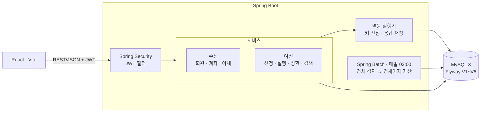
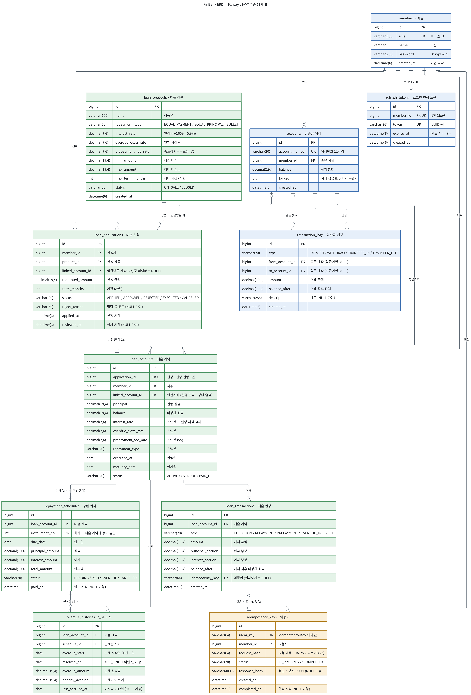

# FinBank

[](https://github.com/zerobak13/FinBank/actions/workflows/ci.yml)

은행의 **수신**(계좌·입출금·이체)과 **여신**(대출 신청 → 실행 → 상환 → 연체)을 Spring Boot로 구현하고, **돈이 맞는지**를 동시성 테스트·불변식·CI로 검증한 백엔드 포트폴리오입니다.

기능을 넓게 늘리기보다 여신 한 도메인을 끝까지 만들었습니다 — 자동심사, 상환 스케줄 계산, 회차 상환·중도상환, 연체 감지·연체이자 배치, 연체이자 수납까지. 설계를 결정할 때마다 근거를 측정값으로 남겼고, AI 에이전트에게 계산 엔진을 맡겨도 결과를 믿을 수 있게 하는 **하네스**도 함께 설계했습니다.

## 한눈에 보기

| 주제 | 한 일 | 결과 |
|---|---|---|
| 동시 출금 | 락 없음과 비관적 락을 같은 조건에서 비교 | 락 없음: 5만 원 증발 · 비관적 락: 오차 0원 |
| 데드락 | 자원 간 락 순서 고정 (이체는 계좌 ID 오름차순, 상환·배치는 계좌 → 대출 → 회차·이력) | 반대 방향 동시 이체 100회 · 배치와 상환이 겹치는 순간, 데드락 0건 |
| 이중 상환 | 조건부 UPDATE + UNIQUE + 멱등키 | 같은 회차 100스레드 → 1건만 · 같은 키 100번 → 출금 1번 |
| 이자 계산 | 순수 자바 엔진을 네 겹으로 검증 | 외부 계산기와 월 상환금 일치 · 무작위 2만 건에서 숨은 버그를 찾아 차단 |
| 대출 검색 | QueryDSL 동적 조건 + 복합 인덱스 | 10만 건에서 조사 행 37배 감소 · 응답 24배 단축 |
| 연체 배치 | 커서 Reader · 멱등 3겹 · 청크 크기 실측 | 5만 건, 청크 100 → 1000에서 3.8배 |
| 테스트 | 실제 MySQL 컨테이너에서 CI | 테스트 563개를 커밋마다 |
| AI 하네스 | 구현·검증 에이전트 분리 + 강제 장치 3겹 | 판정 기준 수정 시도 차단 · 입력 계약 누락 4건 발견 |

각 주제의 설계 과정·코드·숫자는 [전체 가이드](docs/FinBank_전체가이드.md)([PDF](docs/FinBank_전체가이드.pdf))에 장별로 정리했습니다.

---

## 빠르게 실행하기

MySQL을 설치하지 않아도 백엔드와 DB가 한 번에 뜹니다.

```bash
git clone https://github.com/zerobak13/FinBank.git
cd FinBank
cp .env.example .env         # 비밀번호·JWT 키 세 칸을 채운다 (예: openssl rand -base64 32)
docker compose up            # 백엔드 :8080, MySQL :3306
```

- 비밀번호와 JWT 키는 저장소에 없습니다. `.env`(gitignore 대상)에 직접 만든 값을 넣고, 빈 칸이 있으면 compose가 기동 전에 어떤 값이 빠졌는지 알려 줍니다.

- API 문서(Swagger UI): http://localhost:8080/swagger-ui.html — 회원가입 → 로그인 → `Authorize`에 응답의 `accessToken` 값만 넣으면(`Bearer `는 자동) 모든 API를 직접 호출해 볼 수 있습니다.
- 3306 포트를 이미 쓰고 있다면(로컬 MySQL 등) `MYSQL_HOST_PORT=3307 docker compose up`

```bash
# 직접 실행할 때 (MySQL 필요)
cd finbank-backend
./gradlew test        # 테스트 563개 — finbank_test 스키마
./gradlew perfTest    # 성능 측정 (인덱스 10만 건 / 배치 5만 건) — 수동 실행
./gradlew bootRun     # 개발 서버 — finbank 스키마

cd finbank-frontend && npm install && npm run dev   # 화면 :5173
npm test                                            # 화면 테스트 20개 (Node 내장 테스트)
```

개발용(`finbank`)과 테스트용(`finbank_test`) 스키마를 나눴습니다. 테스트가 매번 전 테이블을 비우기 때문에, 같은 스키마를 쓰면 테스트 한 번에 개발 데이터가 사라집니다. DB 접속 정보와 JWT 시크릿은 로컬에서는 gitignore된 `application-local.yml`이, Docker·CI에서는 환경변수가 채웁니다.

---

## 무엇을 만들었나

| 영역 | 기능 |
|---|---|
| 회원·인증 | 회원가입·로그인(Stateless JWT), Refresh Token 재발급(쓸 때마다 새 토큰으로 교체 — 화면은 만료되면 한 번만 재발급하고 같은 요청을 다시 보냄), 로그아웃 |
| 수신 | 계좌 개설, 입금·출금·이체(멱등키), 거래 원장 조회(페이징) |
| 여신 | 상품 조회 → 신청(즉시 자동심사: 한도·연체 2룰) → 실행(상환 스케줄 확정 + 연결계좌 입금) → 회차 상환 · 전액 중도상환(잔여원금 + 경과이자 + 체감식 수수료) |
| 연체 | 매일 02:00 배치 — 납기 지난 회차를 연체로 전환 → 연체이자 일할 가산 → 연체 회차를 갚을 때 연체이자까지 수납 |
| 조회 | 대출 검색(조건 7개 조합 · 페이징), 회차별 스케줄(연체 회차는 쌓인 연체이자까지), 신청 이력 |
| 화면 | React — 계좌·이체, 대출 신청·실행·상환 |

### 기술 스택

| 구분 | 사용 |
|---|---|
| 백엔드 | Java 17, Spring Boot 3.5, Spring Security + JWT, Spring Data JPA, QueryDSL, Spring Batch, Flyway |
| DB | MySQL 8 — 금액은 `DECIMAL(19,4)`, 스키마는 마이그레이션 V1~V8 |
| 프론트엔드 | React, Vite, Tailwind CSS |
| 실행·검증 | Docker Compose, GitHub Actions (MySQL 컨테이너 CI + 판정 기준 가드) |
| AI 하네스 | Claude Code (역할별 에이전트 · PreToolUse hook), Python (가드 · diff 검사) |

### 구조



### 데이터 (ERD)



Flyway V1~V8 기준 11개 표입니다 — 수신·인증 4개(파랑), 여신 6개(초록), 멱등키 1개(노랑). 원본은 [`docs/erd/finbank_erd.mmd`](docs/erd/finbank_erd.mmd)(Mermaid)이고, 키만 남긴 관계도는 [`docs/erd/finbank_erd_keys.png`](docs/erd/finbank_erd_keys.png)입니다.

- **원장은 append-only** — `transaction_logs`(수신)와 `loan_transactions`(여신)는 고치거나 지우지 않고, 거래 직후 잔액을 함께 적습니다. 이체는 보내는 쪽과 받는 쪽 두 줄로 남깁니다. 대출 원장은 원금·이자·연체이자를 칸을 나눠 적고, 연체이자의 발생(`OVERDUE_INTEREST`)과 수납(`REPAYMENT`)은 같은 돈이라 더하지 않습니다.
- **계약 조건은 스냅샷** — 대출 계약은 실행 시점의 금리·연체가산율·중도상환수수료율·상환방식을 복사합니다. 상품 조건이 바뀌어도 이미 맺은 계약은 그대로입니다.
- **중복은 DB 제약이 마지막에 막는다** — 신청 1건당 실행 1건, 대출마다 회차 번호 유일, 같은 멱등키로 거래 1건, 키 선점 1번.
- **조회 경로 인덱스** — 대출 검색용 `(member_id, status, executed_at)`, 연체 배치용 `(status, due_date)`.

---

## 핵심 설계와 근거

### 1. 동시성 — 락을 걸고, 거는 순서까지 정한다

잔액이 바뀌는 모든 연산은 비관적 락(`PESSIMISTIC_WRITE`)으로 보호하고, 락 조회를 그 계좌의 "첫 조회"로 둡니다. 엔티티를 먼저 읽어 두면 1차 캐시 때문에 뒤이은 락 조회가 낡은 값을 돌려주기 때문입니다. 여러 자원을 잠글 때는 순서를 고정합니다 — 이체는 계좌 ID 오름차순, 상환은 계좌 → 대출 → 회차 → 연체 이력. 연결계좌 ID를 알려면 대출을 읽어야 하는 상환은, 대출을 엔티티가 아니라 ID만 먼저 읽습니다. 새벽 배치도 이 순서의 일부(대출 → 회차, 대출 → 이력)로만 잠급니다 — 순서가 엇갈렸던 두 경우는 두 스레드로 그 순간을 재현한 테스트가 MySQL 데드락으로 잡아 줬습니다(가이드 10-8).

잔액 200,000원 계좌에 50개 스레드가 동시에 10,000원씩 출금 (정답: 20건 성공, 잔액 0원):

| 방식 | 성공 | 최종 잔액 | 잔액 오차 | 처리 시간 |
|---|:---:|:---:|:---:|:---:|
| 락 없음 (read-modify-write) | 10 | 150,000원 | **50,000원 증발** | 69ms |
| **비관적 락 (현재 구현)** | **20** | **0원** | **0원** | 60ms |

락이 없으면 로그상 10만 원이 나갔는데 잔액은 5만 원만 줄었고, 데드락(`SQLState 40001`)도 쏟아졌습니다. 이 시나리오에서는 비관적 락이 오히려 빨랐습니다 — 락 없는 쪽은 데드락 → 롤백으로 시간을 잃습니다. 숫자는 실행마다 조금씩 달라지지만 결론은 같습니다.

재현: `./gradlew test --tests "*ConcurrencyBenchmarkTest"` · 자세히: 가이드 5-4

### 2. 이중 처리 — 층마다 막는 것이 다르다

| 사고 | 1차 방어 | 최종 방어 |
|---|---|---|
| 같은 신청을 두 번 실행 | `UPDATE ... WHERE status = 'APPROVED'` — 0행이면 409 | `loan_accounts.application_id` UNIQUE |
| 같은 회차를 두 번 상환 | `UPDATE ... WHERE status IN ('PENDING', 'OVERDUE')` | `loan_transactions.idempotency_key` UNIQUE |
| 버튼 두 번 · 네트워크 재시도 | 멱등키 선점 | 위 두 제약 |
| 신청 취소와 실행이 같은 순간 | `UPDATE ... WHERE status IN ('APPLIED', 'APPROVED')` — 먼저 바꾼 쪽만 1행 | 진 쪽은 409와 현재 상태 |
| 새벽 배치와 상환이 같은 회차·이력을 | 배치도 조건부 UPDATE (`status = 'PENDING'`, `resolved_at IS NULL`) | 같은 락 순서 |

**조건부 UPDATE가 핵심인 이유**: MySQL 기본 격리수준(REPEATABLE READ)에서 일반 SELECT는 트랜잭션 시작 시점의 스냅샷을 읽습니다. 락을 기다렸다 들어온 두 번째 요청이 이미 상환된 회차를 "아직 PENDING"으로 볼 수 있다는 뜻입니다. UPDATE는 항상 최신 커밋본으로 조건을 평가하므로 영향 행 0으로 정확히 막힙니다. 엔티티를 읽어 고치는 방식은 또 하나의 함정이 있습니다 — 변경 감지가 **행 전체**를 읽었던 값으로 다시 써서, 그 사이 다른 쪽이 바꾼 값(방금 상환된 회차, 닫힌 연체 이력)까지 되돌립니다. 그래서 경쟁이 있는 상태 전이(신청 실행·취소, 회차 상환, 배치의 연체 전환·연체이자 가산)는 도메인 메서드를 두지 않고 이 UPDATE로만 바꾸며, 테스트 데이터도 같은 UPDATE로 만듭니다.

### 3. 멱등키 — 두 번 눌러도 한 번만 나가게

돈이 움직이는 API(대출 실행·회차 상환·전액 중도상환·이체)는 `Idempotency-Key` 헤더가 필수입니다. 같은 키의 두 번째 요청에는 저장해 둔 응답을 그대로 돌려줍니다(토스·Stripe 등 금융 API의 표준 패턴). 핵심은 트랜잭션 경계입니다.

| 단계 | 전파 속성 | 이유 |
|---|---|---|
| 키 선점 (INSERT) | `REQUIRES_NEW` | 본 처리와 묶이면 롤백 때 키도 사라져 동시 재시도를 못 막는다 |
| 응답 확정 | `MANDATORY` | 돈이 움직인 사실과 응답 스냅샷이 같은 커밋에 있어야 한다 |
| 실패 시 키 해제 | `REQUIRES_NEW` | 롤백되는 트랜잭션에 얹으면 해제도 함께 사라진다 |

선점의 승패는 `idempotency_keys.idem_key` UNIQUE가 정합니다 — "조회 후 없으면 INSERT"는 동시 요청 둘 다 통과하지만, UNIQUE는 반드시 하나만 통과시킵니다. 같은 키로 다른 내용을 보내면 요청 해시(SHA-256)가 달라 422로 거부합니다.

100개 스레드가 **같은 회차**를 동시에 상환 (1회차 860,205원):

| 시나리오 | 성공 응답 | 409 | 상환 원장 | 계좌 출금 |
|---|---:|---:|---:|---:|
| 서로 다른 요청 100개 | **1** | 99 | 1건 | 1회 |
| 같은 멱등키 100번 재시도 | 70 (처리 1 + 재생 69) | 30 | **1건** | **1회** |

두 번째 줄이 멱등키가 있는 이유입니다 — 70개가 성공 응답을 받았지만 돈은 한 번만 움직였습니다(`LoanRepaymentConcurrencyTest`).

### 4. 돈 계산 — 하나의 정책, 네 겹의 검증

금액은 `BigDecimal`(DB `DECIMAL(19,4)`)이고, 스케일·반올림 규칙은 `MoneyPolicy` 한 곳에만 둡니다 — 중간 계산 scale 10, 확정 금액은 원 미만 절사, 일할 계산은 연 365일. 원리금균등·원금균등·만기일시 상환 스케줄 생성기는 Spring에 의존하지 않는 순수 자바로 만들고 네 겹으로 검증했습니다.

1. **확정 기대값** — 손으로 계산한 회차별 원금·이자·잔액을 그대로 단언
2. **속성 테스트 240조합** — 금액 4 × 금리 4 × 기간 5 × 방식 3에서 "회차 원금 합 = 대출 원금, 최종 잔액 0, 잔액 단조감소"
3. **외부 계산기 대조** — 원금 1,000만 원 · 연 6% · 12개월 원리금균등에서 월 상환금 **860,664원 정확히 일치**. 회차 이자가 최대 9원 다른 건 계산기가 10원 미만을 절사하기 때문입니다(FinBank는 원 미만 절사). 반올림 오차는 마지막 회차가 흡수합니다(12회차 860,662원) — 빼먹으면 완납 후에도 잔액이 몇 원 남습니다.
4. **불변식 하네스** — 불변식 25개를 ID와 함께 한 파일에 모으고, 사람이 고른 케이스·AI가 만든 케이스·고정 시드 무작위 2만 건을 같은 판정기로 검사합니다. 무작위 탐색이 240조합이 놓친 원리금균등 버그(만기 전에 잔액이 음수가 되는 입력 588건)를 찾았고, 이런 입력은 이제 거부합니다.

### 5. 대출 검색 — 인덱스 컬럼 순서가 곧 성능

조건 7개(상태·상환방식·상품·실행일 구간·원금 구간)가 모두 선택이라 QueryDSL로 조립합니다. 값이 없는 조건은 WHERE에서 빠지고, 오타는 컴파일이 막습니다.

한 회원의 대출 10만 건에서 "최근 30일 안에 실행된 정상 대출" COUNT:

| 인덱스 | 실행 계획 | 조사 행 | 평균 응답 |
|---|---|---:|---:|
| 없음 | ALL (풀스캔) | 99,400 | 26.83ms |
| `(member_id, status, executed_at)` | range | **2,664** | **1.13ms** |

등치 조건을 앞에, 범위 조건(`executed_at`)을 마지막에 둬야 범위 탐색이 좁아집니다. 정렬이 붙은 목록 쿼리에서는 옵티마이저가 PK 역순 스캔을 골랐는데, 데이터 분포에 기대는 계획이라 한계로 기록해 뒀습니다(가이드 9장).

### 6. 연체 배치와 연체이자 수납

매일 02:00에 두 배치가 차례로 돕니다. 납기 지난 미납 회차를 연체로 바꾸고 이력을 만드는 **연체 감지**, 진행 중인 연체에 밀린 날만큼 이자를 붙이는 **연체이자 가산**입니다. 연체이자 = 연체 원리금 × min(약정금리 + 연체가산율, 법정 최고 20%) × 일수 / 365.

- **offset 페이징의 함정** — 이 배치들은 읽은 행을 바꿔 스스로 조회 조건에서 빠집니다. offset으로 읽으면 다음 페이지가 당겨져 절반을 건너뛰고도 "정상 종료"합니다. 그래서 마지막으로 읽은 id 다음부터 읽는 커서 Reader로 만들고, 청크 경계를 넘는 250건 테스트로 고정했습니다.
- **멱등 3겹** — Spring Batch JobInstance(같은 기준일 재실행 거부), 감지는 `status = PENDING` 조건, 가산은 `lastAccruedAt < 기준일` 조건. 처리 완료 표시를 데이터에 남기고 그 표시를 읽기 조건에 넣었습니다. 배치가 밀려도 다음 실행이 밀린 일수만큼 한 번에 붙입니다.
- **상환과 겹칠 때** — 배치도 읽어 둔 엔티티를 고쳐 쓰지 않고 조건부 UPDATE로만 바꿉니다. 처음엔 엔티티를 고쳐 써서, 읽은 뒤 끝난 상환을 청크가 커밋될 때 옛 값으로 되돌릴 수 있었습니다(트러블슈팅 10).
- **연체이자 수납** — 연체 회차를 갚으면 원리금과 쌓인 연체이자를 한 번에 출금하고, 이력을 닫아 가산을 멈춥니다. 잔액이 모자라면 일부만 받지 않고 전부 거절하며 필요한 금액을 알려 줍니다 — `상환에 필요한 금액은 1,051,150원(연체이자 1,150원 포함)이고, 현재 잔액은 1,050,000원입니다.` 원장에는 상환 한 건이 한 줄로 남고(거래 금액 = 계좌 출금액) 약정 이자와 연체이자는 칸을 나눠 적습니다(V8). 응답도 `penaltyPortion`으로 연체이자를 따로 보여 줍니다.

5만 건 연체 감지, 청크 크기별:

| 청크 | 처리시간 | 커밋 | 건당 |
|---:|---:|---:|---:|
| 100 | 37,969ms | 500 | 759µs |
| 500 | 12,418ms | 100 | 248µs |
| **1000** | **9,927ms** | **50** | **198µs** |

100 → 1000에서 3.8배 빨라졌지만 500 → 1000은 1.25배로, 수확이 급격히 줄어듭니다. 청크가 커지면 실패 시 되돌릴 범위와 메모리에 올리는 엔티티도 늘어나므로, 기본값 100을 두고 잡 파라미터로 조정할 수 있게 열어 뒀습니다.

### 7. 예외 — 상태 코드가 이유를 말한다

서비스는 의미에 맞는 `ErrorCode`만 고르고, 상태 코드는 코드가 정합니다(매핑은 `GlobalExceptionHandler` 한 곳).

| 상태 | 뜻 | 예 |
|---|---|---|
| 400 | 요청이 규칙에 어긋남 | 잔액 부족, 금액 0 이하·소수, 멱등키 누락, 빠진 파라미터, 깨진 JSON, 형식이 틀린 값 |
| 401 | 누군지 모름 | 로그인 실패, 토큰 없음·만료 |
| 403 | 누군지는 알지만 권한 없음 | 남의 계좌·대출 (락을 걸기 전에 확인) |
| 404 · 405 | 없음 · 그 주소에 없는 요청 방식 | 없는 계좌·주소 · 조회 주소에 `PUT` |
| 409 | 지금 상태와 충돌 | 이미 실행·상환됨, 처리 중, 이미 가입된 이메일 |
| 422 | 형식은 맞지만 처리 불가 | 상품 범위 밖 금액·기간, 같은 멱등키로 다른 요청 |
| 503 | 잠깐 안 됨 (서버 사정) | 계좌번호 생성 실패 — 잠시 후 다시 |

예외 체계는 점진 이관(expand-contract)으로 바꿨습니다 — 코드 기반 생성자를 먼저 더하고, 문자열 예외를 모두 옮긴 뒤 옛 생성자를 지웠습니다. 스프링이 던지는 요청 오류(없는 주소, 요청 방식, 형식)도 500으로 뭉치지 않고 스프링이 정한 4xx 그대로 내보냅니다 — 500은 정말 예상하지 못한 오류에만 남깁니다.

---

## 테스트와 CI

테스트 **563개**가 push·PR마다 GitHub Actions에서 돕니다(성능 측정 2개는 `perf` 태그로 분리 — CI 시간이 곧 개발 피드백 속도입니다). 통합 테스트는 **실제 MySQL 8 컨테이너**에서 돕니다. 비관적 락, 조건부 UPDATE, REPEATABLE READ 스냅샷처럼 이 프로젝트가 증명하려는 동작은 DB 엔진의 특성이라, H2로 바꾸면 검증 자체가 무의미해지기 때문입니다.

| 묶음 | 개수 | 대표 테스트 |
|---|---:|---|
| 수신 (동시성·규칙·멱등) | 25 | `WithdrawConcurrencyTest`, `AccountServiceDeadlockTest`, `TransferIdempotencyTest`, `CashIdempotencyTest` |
| 인증 (가입·재발급·로그아웃) | 5 | `AuthServiceTest` |
| 공통 (예외·페이지) | 8 | `GlobalExceptionHandlerTest`, `PagingPolicyTest` |
| 여신 계산 엔진 | 270 | `ScheduleGeneratorTest`, `ScheduleGeneratorPropertyTest`(240조합) |
| 불변식 하네스 | 190 | `CalculatorInvariantsTest`(143조합), `ScheduleCaseFileTest`(사람 10건 + AI 32건) |
| 여신 통합 (실제 DB) | 49 | `LoanExecutionServiceTest`, `LoanRepaymentServiceTest`, `LoanRepaymentConcurrencyTest`, `LoanPrepaymentConcurrencyTest` |
| 배치 | 16 | `OverdueDetectionJobTest`(250건 청크 경계, 상환과 겹치는 순간), `OverdueInterestAccrualJobTest` |

화면 테스트 20개(`npm test` — 토큰 재발급·금액 규칙)도 CI의 프론트 job에서 빌드와 함께 돕니다.

PR이 판정 기준 파일(불변식·하네스·CI 설정)을 바꾸면 `oracle-approved` 라벨 없이는 통과하지 않는 **Harness Guard**도 함께 돕니다. 가드는 PR에 담긴 코드가 아니라 기준 브랜치의 코드로 돌아서, 같은 PR이 규칙을 고쳐 스스로를 통과시킬 수 없습니다.

---

## AI 에이전트 하네스 — 만드는 AI와 검증하는 AI

AI에게 코드를 맡길 때 금융권이 먼저 묻는 것은 "AI가 만든 결과를 어떻게 믿나"입니다. 그래서 AI를 서비스에 붙이는 대신, AI가 여신 계산 엔진을 고칠 때 **믿을 수 있는 결과만 남도록** 개발 환경을 설계했습니다.

- **만드는 쪽과 검증하는 쪽을 나눈다** — 구현 에이전트와 검증 에이전트는 서로 다른 세션입니다. 자기 코드를 자기가 검증하면 같은 맹점을 공유합니다.
- **판정은 결정적인 코드가 한다** — 불변식 하네스(JUnit)·hook·CI가 판정하고, AI는 구현과 케이스 만들기만 합니다.
- **판정 기준은 사람만 고친다** — AI가 테스트를 느슨하게 고쳐 통과시키는 일을 지시문이 아니라 구조로 막습니다.

```
사람: task.md(명세) + 판정 기준(불변식 25개)
  ↓
구현 에이전트 ── src/main만 수정 → fast-test (457개, DB 불필요)
  ↓  사람: diff 가드 → 커밋
검증 에이전트 ── llm-cases.csv 끝에 케이스 추가 → fast-test → verify-N.md
  ↓  사람: 판단 → 다음 라운드 또는 PR (판정 기준이 바뀌면 oracle-approved 라벨)
```

강제 장치는 3겹이고, 규칙의 단일 출처는 `scripts/harness/harness_rules.py`입니다.

1. **PreToolUse hook** — 도구를 부르기 직전마다 역할별 경로·명령을 검사해 위반이면 막고 기록합니다. 가드가 고장 나도 막습니다(fail-closed).
2. **git diff 가드** — 라운드가 끝나면 실제로 바뀐 파일을 같은 규칙으로 다시 검사합니다(셸 우회까지).
3. **CI 판정 기준 가드** — 판정 기준이 바뀐 PR은 `oracle-approved` 라벨 없이는 실패합니다.

가드 자체도 단위 테스트 30개로 검증합니다.

**실전 결과 — 상환 스케줄 입력 계약** ([`harness-reports/demo/`](harness-reports/demo/summary.md))

| 단계 | 결과 |
|---|---|
| 시연 | 구현 에이전트의 판정 기준 수정 시도 2회를 hook이 막고 기록 |
| 검증 1라운드 | 코드를 읽고 노린 케이스로 **입력 계약 누락 4건** 발견 — 원 미만 원금, 법정 최고금리 초과, 날짜 범위 초과 시 계약 밖 예외, 기간 상한 부재(OutOfMemoryError) |
| 명세 | 사람이 INP-01~04 확정(금리 20% 이하, 기간 600개월 이하 등) → 판정 기준에 먼저 반영(구현 전까지 의도된 실패) |
| 구현 1라운드 | 파일 4개 수정 → 빠른 테스트 통과, 무작위 2만 건 위반 0 · 계약 밖 통과 0 |
| 검증 2라운드 | 경계값 29건 추가 → 실패 0 |

```bash
scripts/harness/run-agent.sh implementer   # 터미널 A — 구현 에이전트
scripts/harness/run-agent.sh verifier      # 터미널 B — 검증 에이전트
scripts/harness/fast-test.sh               # 빠른 테스트 (계산 엔진 + 불변식 하네스)
```

---

## 트러블슈팅

| # | 문제 | 원인 | 해결 · 교훈 |
|---|---|---|---|
| 1 | BigDecimal 전환 후 잔액 단언이 전부 실패 | `equals`는 스케일까지 비교한다 (`30000` ≠ `30000.0000`) | 비교는 `compareTo`·`isEqualByComparingTo`로, 응답은 `MoneyPolicy.toWon()`으로 스케일 0 |
| 2 | 새 마이그레이션이 "적용됨"으로만 기록되고 실행되지 않음 | 로컬 DB에 실험 브랜치의 V3 기록이 남아 Flyway가 건너뜀 | 로컬 DB를 비우고 다시 적용. 적용된 마이그레이션은 고치지 않고, 공유 DB라면 전진 수정 |
| 3 | 손대지 않은 테스트가 어느 날 실패 | 테스트 계좌번호에 `System.nanoTime()`을 붙였는데, 가동시간이 길어지자 자릿수가 늘어 컬럼 길이 초과 | 픽스처도 운영과 같은 형식(12자리 숫자)으로 고정 |
| 4 | 측정하려던 인덱스를 지울 수 없음 | 복합 인덱스가 생기자 MySQL이 FK 전용 인덱스를 조용히 지워, 복합 인덱스가 FK를 떠받치게 됨 | 스키마를 건드리지 않고 `IGNORE INDEX` 힌트로 측정 |
| 5 | 연체 회차를 다 갚아도 이자가 계속 붙음 | 상환이 연체 이력을 닫지 않음 — 배치가 생기기 전엔 증상이 없었음 | 상환할 때 이력을 닫고, 이후 쌓인 연체이자도 함께 받도록 보완 |
| 6 | 테스트 설정 파일 하나를 추가하자 통합 테스트 53개가 실패 | 같은 이름의 설정 파일은 합쳐지지 않고 통째로 대체됨 | 시스템 프로퍼티로 필요한 키만 덮어씀 |
| 7 | 240조합이 놓친 원리금균등 버그 | 이자 절사와 납입액 반올림의 차이가 복리로 쌓여 만기 전 잔액이 음수 | 무작위 탐색으로 발견 → 입력 거부 + 회귀 케이스로 고정. 사람이 고른 입력은 사람의 상상력만큼만 안전하다 |
| 8 | 토큰이 만료돼도 화면이 로그아웃되지 않음 | 서버가 401로 바뀌었는데 화면은 메시지에 `"HTTP 403"`이 있는지로 판단 — 서버 쪽만 검색해 놓침 | 상태 코드로 판단하고, 401이면 재발급 후 재시도. 응답 계약을 바꿀 땐 그 값을 읽는 쪽까지 찾는다 |
| 9 | 원장의 이자를 더하면 연체이자가 두 번 잡힘 | 연체이자의 발생(배치)과 수납(상환)을 둘 다 이자 칸에 적음 | 연체이자 칸을 따로 두고(V8) 발생과 수납을 더하지 않는다는 규칙을 명시 |
| 10 | 새벽 배치가 방금 끝난 상환을 되돌릴 수 있었음 (코드 재점검에서 발견) | 배치가 읽어 둔 엔티티를 고쳐 씀 — 변경 감지는 행 전체를 읽었던 값으로 다시 쓴다 | 조건부 UPDATE로 바꾸자 락 순서가 엇갈린 데드락 2건이 드러남(하나는 인덱스 선택 때문) → 배치도 대출부터 잠그고 그 조회의 인덱스를 고정. 요청 경로의 원칙은 같은 행을 건드리는 모든 경로에 적용한다 |

자세한 경위는 [전체 가이드](docs/FinBank_전체가이드.md) 16장에 있습니다.

---

## 알려진 한계와 다음 단계

- **장기 상품** — 원리금균등이 깨지는 입력은 지금 거부합니다. 주택담보처럼 긴 상품을 넣으려면 잔여 회차 재산정 방식으로 바꾸고, 엔진의 거부를 신청 단계에서 422로 미리 걸러야 합니다(지금은 사용자 입력이 엔진까지 가지 않습니다).
- **연체 정산 확장** — 상환일까지의 일할 정산, 일부만 갚을 때의 충당 순서, 감면.
- **동시 신청의 한도** — 같은 회원의 신청 두 건이 정확히 같은 순간에 오면 서로를 보지 못한 채 둘 다 한도 심사를 통과할 수 있습니다(회원 단위 잠금 없음, 가이드 7-5).
- **배치 다중화** — `@Scheduled`는 인스턴스마다 돕니다. 서버를 늘리면 ShedLock이나 외부 스케줄러로 실행 주체를 하나로 만들어야 합니다(지금은 단일 인스턴스이고, 멱등 3겹이 중복 실행을 막습니다).
- **정렬이 붙은 목록 쿼리** — 커버링 인덱스나 커서 기반 페이징.
- **인증 강화** — Refresh Token을 DB에 원문으로 저장합니다(해시로 저장하는 것이 다음 단계). 로그인 시도 횟수 제한도 없고, 토큰은 브라우저 localStorage에 둡니다(HttpOnly 쿠키는 CSRF 대비와 함께 검토).
- **멱등키 정리** — 처리 중(IN_PROGRESS)에 서버가 죽으면 그 키는 계속 409로 남습니다(시간 초과 회수 없음). 오래된 키를 지우는 정리 작업도 없습니다.
- **배포** — 초기 버전(2026-01)은 Vercel·Render·Aiven MySQL에 배포했습니다. 여신 모듈을 포함한 재배포는 운영 DB 마이그레이션 점검 후 진행합니다.
- **하네스 자동화** — 구현 → 검사 → 검증 → 반려를 스크립트 루프로.

## 더 읽을거리

- [전체 가이드](docs/FinBank_전체가이드.md) ([PDF](docs/FinBank_전체가이드.pdf)) — 설계·코드·DB·테스트를 한 권으로. 처음이라면 19장 "처음부터 따라가며 보기"부터
- [ERD 원본](docs/erd/) — Mermaid 파일과 다시 그리는 스크립트(`render.sh`)
- [하네스 실전 기록](harness-reports/demo/summary.md) — 라운드별 요약
