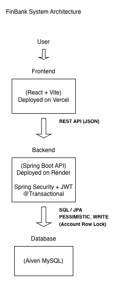
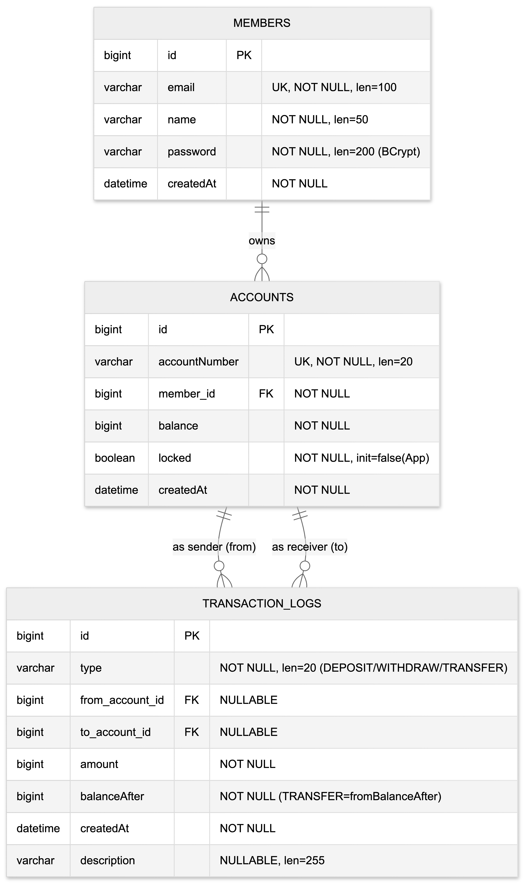

# FinBank

[](https://github.com/zerobak13/FinBank/actions/workflows/ci.yml)

금융 거래의 **무결성과 동시성 문제**를 중심으로 설계한  
백엔드 중심의 금융 서비스 포트폴리오 프로젝트입니다.

실제 배포 환경에서 동작하는 API 서버와 데이터베이스를 기반으로  
인증, 트랜잭션, 동시성 제어를 구현하고 검증하는 데 초점을 두었습니다.

---

## Live Demo

- **Frontend**: https://finbank-frontend.vercel.app
- **Backend API**: https://finbank-backend.onrender.com

> ⚠️ Render 무료 티어 특성상 첫 요청 시 서버 기동에 약 1분 정도 소요될 수 있습니다.

---

##  Tech Stack

### Backend
- Java 17
- Spring Boot 3
- Spring Security
- JWT Authentication
- Spring Data JPA
- MySQL (Aiven)

### Frontend
- React
- Vite
- TailwindCSS

### Infrastructure
- Vercel (Frontend)
- Render (Backend)
- Aiven MySQL (Database)

---

##  System Architecture



본 프로젝트는 프론트엔드, 백엔드, 데이터베이스를 분리하여  
각 계층의 책임을 명확히 하도록 설계했습니다.

- 사용자는 프론트엔드를 통해 요청을 전달합니다.
- 프론트엔드는 REST API(JSON)를 통해 백엔드와 통신합니다.
- 인증, 트랜잭션, 동시성 제어는 백엔드의 책임으로 관리합니다.
- 데이터베이스 접근은 백엔드에서만 이루어집니다.
- 금융 거래의 무결성을 위해 트랜잭션과 **비관적 락(PESSIMISTIC_WRITE)**을 적용했습니다.

---

##  ERD (Entity Relationship Diagram)



계좌(Account)를 중심으로 거래 로그(Transaction Log)를 분리하여  
금융 거래 이력 관리와 검증이 가능하도록 모델링했습니다.

### 주요 설계 포인트
- 회원(Member) 1 : N 계좌(Account)
- 계좌 간 거래는 `TRANSACTION_LOGS` 테이블에서 관리
- 입금 / 출금 / 이체를 하나의 로그 테이블로 통합
- 거래 이후의 잔액(`balance_after`)을 기록하여 이력 추적 가능

---

##  Authentication & Security

- **JWT 기반 인증**을 적용하여 Stateless한 인증 구조를 구성했습니다.
- Spring Security를 통해 인증/인가를 처리합니다.
- CORS 설정을 통해 허용된 프론트엔드 도메인에서만 API 접근을 허용했습니다.

---

##  Transaction & Concurrency Control

금융 서비스에서 가장 중요한 **동시성 문제와 잔액 무결성**을 중점적으로 고려했습니다.

### 트랜잭션 처리
- 모든 금액 변경 로직은 `@Transactional` 범위 내에서 처리합니다.
- 이체 로직은 내부적으로 **Transfer Out / Transfer In** 단계로 분리하여 처리합니다.

### 동시성 제어
- 계좌 조회 시 `PESSIMISTIC_WRITE` 비관적 락을 적용했습니다.
- 동시에 여러 거래가 발생하더라도 잔액 불일치가 발생하지 않도록 설계했습니다.

### 동시성 검증 결과 (벤치마크)

잔액 **200,000원** 계좌에 **50개 스레드가 동시에 10,000원씩 출금**을 시도한 벤치마크입니다.
정상적으로 처리되면 정확히 **20건만 성공하고 잔액은 0**이 되어야 합니다.
"락 없이 read-modify-write" vs "비관적 락(현재 구현)"을 비교한 대표 실행 결과:

| 방식 | 성공(WITHDRAW 로그) | 최종 잔액 | 잔액 오차 (lost update) | 처리 시간 |
|------|:---:|:---:|:---:|:---:|
| 락 없음 (read-modify-write) | 10 | 150,000원 | **50,000원 증발** | 69ms |
| **비관적 락 (현재 구현)** | **20** | **0원** | **0원 (정합)** | 60ms |

- **정합성**: 락 없이 처리하면 로그상 10만원이 출금됐는데 잔액은 5만원만 줄어 **5만원이 증발**(lost update)했습니다. 비관적 락은 정확히 20건만 성공하고 잔액이 0으로, 한도만큼만 정확히 인출됩니다.
- **안정성**: 락 없는 경쟁에서는 `Deadlock found (SQLState 40001)`이 대량 발생해 상당수 요청이 롤백됐습니다.
- **속도**: 이 시나리오에서는 오히려 비관적 락이 더 빨랐습니다 — 락 없는 쪽은 데드락 → 롤백 → 재시도로 지연됩니다.
- **재현**: `./gradlew test --tests "com.finbank.backend.service.ConcurrencyBenchmarkTest"` (`ConcurrencyBenchmarkTest`)

> 숫자는 타이밍/데드락에 따라 실행마다 다소 달라지지만, "락 없음 = lost update·데드락 / 비관적 락 = 정합·안정"이라는 결론은 항상 동일합니다.

---

##  Testing

모든 기능을 포괄적으로 테스트하기보다는,  
금융 서비스에서 가장 위험도가 높은 시나리오에 집중하여 테스트를 작성했습니다.

### 테스트 전략
- 동시 이체 상황에서의 잔액 무결성 검증
- 여러 스레드에서 동시에 접근하는 경우에도 데이터 정합성 유지 확인
- CountDownLatch를 활용한 동시성 테스트

> 테스트는 “개수”보다 **위험도가 높은 영역을 정확히 검증하는 것**을 목표로 했습니다.

### CI (GitHub Actions)

push·PR마다 백엔드 빌드/테스트와 프론트엔드 빌드가 자동으로 돕니다. 현재 테스트 **321개**가 매 커밋마다 실행됩니다. (10만 건을 적재하는 성능 측정은 `perf` 태그로 분리해 CI에서 제외 — CI 시간은 곧 개발 피드백 속도입니다.)

통합 테스트는 **실제 MySQL 컨테이너**에서 돌립니다. 비관적 락, 조건부 UPDATE, REPEATABLE READ 스냅샷처럼 이 프로젝트가 증명하려는 동작은 대부분 DB 엔진의 특성이라 H2로 바꾸면 검증 자체가 무의미해지기 때문입니다. 잡마다 컨테이너가 새로 뜨므로 로컬 DB 상태에 오염되지도 않습니다 — Flyway 유령 마이그레이션으로 하루를 날린 경험(트러블슈팅 2번)의 구조적인 해법이기도 합니다.

```bash
# 로컬 실행 (MySQL 필요)
cd finbank-backend && ./gradlew test
```

DB 접속 정보와 JWT 시크릿은 로컬에서는 gitignore된 `application-local.yml`이, CI에서는 환경변수가 채웁니다.

---

##  금액 처리 정책 (BigDecimal)

여신(대출) 모듈의 이자 계산을 앞두고 금액 타입을 `Long`(원 단위 정수)에서 **`BigDecimal`(DB `DECIMAL(19,4)`)**로 전환했습니다.

- **전환 시점**: 이자·수수료처럼 소수 연산이 필요한 도메인이 들어오기 "직전"에 전환 — 타입이 갈라진 채 모듈이 늘어나면 재작업 비용이 커지기 때문입니다.
- **정책의 단일 출처**: 스케일·반올림 규칙을 `MoneyPolicy` 클래스 하나에 고정했습니다. (중간 계산 scale 10 / 확정 금액은 원 미만 절사 / 일할 계산 연 365일 고정)
- **점진 이관(expand-contract)**: 기존 `BusinessException(String)` 생성자를 유지한 채 `ErrorCode` 기반 생성자를 추가해, 기존 코드 무수정으로 409/422 상태코드 구분이 가능한 예외 체계를 도입했습니다.

---

##  이자 계산 엔진 검증 (여신)

원리금균등·원금균등·만기일시 3종 상환 스케줄 생성기를 **순수 자바**(Spring/JPA 무의존)로 구현하고, 3층으로 검증했습니다.

1. **확정 기대값 테스트** — 수식을 손으로 계산한 회차별 원금/이자/잔액을 그대로 단언
2. **속성(불변식) 테스트 240조합** — 금액 4 × 금리 4(0% 포함) × 기간 5 × 방식 3에 대해 "Σ회차원금 == 대출원금, 최종잔액 == 0, 잔액 단조감소"가 항상 성립하는지 검증
3. **외부 계산기 대조** — 공개 대출이자 계산기와 동일 조건 비교 (아래)

### 외부 계산기 대조 결과

조건: 원금 10,000,000원 / 연 6% / 12개월 / 원리금균등

**월 상환금: 860,664원 — 정확히 일치** ✅

| 회차 | FinBank 이자 | 계산기 이자 | 차이 |
|---:|---:|---:|---:|
| 1 | 50,000 | 50,000 | 0 |
| 2 | 45,946 | 45,940 | +6 |
| 3 | 41,873 | 41,870 | +3 |
| 11 | 8,542 | 8,540 | +2 |

**차이 원인 분석**: 계산기의 이자값이 전부 10원 배수인 점에서, 해당 계산기는 이자를 **10원 미만 절사**하는 정책임을 확인했습니다. FinBank는 국내 은행 관행에 맞춰 **원 미만 절사**(`MoneyPolicy` 단일 출처)를 사용합니다. 회차당 최대 9원의 차이는 정책 차이일 뿐 수식은 동일하며, 월 상환금 A가 완전 일치하는 것이 그 증거입니다. 양쪽 모두 반올림 누적 오차를 **마지막 회차가 흡수**(끝수 조정)합니다 — FinBank의 12회차 상환액이 860,664원이 아닌 860,662원인 이유이고, 이를 빼먹으면 완납 후 잔액이 ±수 원 남는다는 것을 테스트로 증명해 두었습니다.


---

##  대출 실행·상환과 멱등키 (C3)

승인된 신청을 **실행**하면 계약(원장)이 생기고 상환 스케줄 전 회차가 확정 저장되며 연결계좌에 원금이 입금됩니다. 이후 회차 **상환**과 **전액 중도상환**이 가능합니다. 돈이 움직이는 이 세 API는 모두 `Idempotency-Key` 헤더가 필수입니다.

### 멱등키 — 두 번 눌러도 한 번만 나가게

사용자가 상환 버튼을 두 번 누르거나 네트워크 타임아웃으로 클라이언트가 재시도하면 같은 의도의 요청이 서버에 두 번 도착합니다. 클라이언트가 요청마다 UUID를 보내고, 서버는 같은 키의 두 번째 요청에 **저장해둔 응답을 그대로** 돌려줍니다(토스·Stripe 등 금융 API의 표준 패턴).

핵심은 **트랜잭션 경계**입니다.

| 단계 | 전파 속성 | 이유 |
|---|---|---|
| 키 선점(INSERT) | `REQUIRES_NEW` | 본 처리와 같은 트랜잭션이면 롤백 시 키도 사라져 동시 재시도를 못 막는다 |
| 응답 확정(COMPLETED) | `MANDATORY` (본 처리와 같은 트랜잭션) | "돈이 움직인 사실"과 "응답 스냅샷"이 같은 커밋에 묶여야 한다 |
| 실패 시 해제(DELETE) | `REQUIRES_NEW` | 롤백되는 트랜잭션에 얹으면 삭제도 함께 사라진다 |

선점의 승패는 `idempotency_keys.idem_key` **UNIQUE 제약**이 결정합니다. "조회 후 없으면 INSERT"는 동시 요청 둘 다 통과하지만, UNIQUE는 반드시 하나만 통과시킵니다 — 경쟁의 중재를 애플리케이션이 아니라 DB에 맡기는 이유입니다. 같은 키로 다른 내용을 보내면 요청 해시(SHA-256)가 달라 422로 거부합니다.

### 이중 처리 방어 — 층마다 막는 것이 다르다

| 사고 유형 | 1차 방어 | 최종 방어 |
|---|---|---|
| 같은 신청 이중 실행 | 조건부 상태 전이 `UPDATE ... WHERE status='APPROVED'` (0행이면 409) | `loan_accounts.application_id` UNIQUE |
| 같은 회차 이중 상환 | 조건부 전이 `UPDATE ... WHERE status IN ('PENDING','OVERDUE')` | `loan_transactions.idempotency_key` UNIQUE |
| 버튼 두 번 / 재시도 | 멱등키 선점 | 위 두 제약 |

**조건부 UPDATE가 핵심인 이유**: MySQL 기본 격리수준(REPEATABLE READ)에서 일반 SELECT는 트랜잭션 시작 시점의 스냅샷을 읽습니다. 락을 기다렸다 통과한 두 번째 요청이 "이미 상환된 회차"를 **아직 PENDING인 것으로 볼 수 있다**는 뜻입니다. 반면 UPDATE는 항상 최신 커밋본을 기준으로 조건을 평가하므로, 영향 행 수 0으로 정확히 막힙니다. 상태 검사와 상태 변경을 DB의 한 문장으로 합치는 것이 check-then-act 경쟁을 없애는 방법입니다.

### 데드락 방지 — 자원 유형 간 락 순서 고정

상환은 계좌와 대출 두 자원을 동시에 잠급니다. 전역 규칙은 **`Account` → `LoanAccount` 순서**입니다(이체의 "ID 오름차순" 규칙과 같은 목적). 그런데 연결계좌 ID는 대출을 읽어야 알 수 있으므로, 대출을 **엔티티가 아니라 ID만 프로젝션으로** 먼저 읽습니다. 엔티티를 먼저 읽으면 1차 캐시 때문에 뒤이은 락 조회가 락 이전의 낡은 값을 돌려주기 때문입니다(Phase A에서 확인한 함정).

### 동시성 검증 결과 (상환)

100개 스레드가 **같은 회차**를 동시에 상환 시도 — 정상이라면 정확히 1건만 성공해야 합니다.

조건: 원금 1,000만 / 연 5.9% / 12개월 원리금균등 → 1회차 총액 **860,205원**

| 시나리오 | 성공(응답) | 409 충돌 | 기타 예외 | 상환 원장 | 계좌 출금 | 잔액 감소 |
|---|---:|---:|---:|---:|---:|---:|
| 서로 다른 100개 요청 | **1** | 99 | 0 | 1건 | 1회 | 860,205원 |
| 같은 멱등키 100개 재시도 | 70 (1회 처리 + 69회 응답 재생) | 30 | 0 | **1건** | **1회** | 860,205원 |

두 번째 줄이 멱등키의 존재 이유입니다. 100개 요청 중 70개가 **성공 응답을 받았지만** 돈은 한 번만 움직였습니다 — 70개 중 69개는 저장된 응답의 재생이고, 나머지 30개는 선점 경쟁 중(IN_PROGRESS)이라 409를 받았습니다. 락 대기 타임아웃이나 데드락 같은 "기타 예외"는 0건이며, 계좌 잔액 감소액은 회차 총액과 1원도 다르지 않습니다.

이 테스트는 `LoanRepaymentConcurrencyTest`로 코드에 남아 언제든 재현됩니다.

### 중도상환

전액 중도상환 시 **잔여원금 + 경과이자 + 중도상환수수료**를 한 번에 출금합니다.
- 경과이자 = 잔여원금 × 약정금리 × (직전 납부 기준일 ~ 상환일) / 365
- 수수료 = 잔여원금 × 수수료율 × 잔존일수 / 총 대출일수 (잔존기간 체감 — 만기일 상환 시 0원)
- 수수료율도 **실행 시점 스냅샷**입니다. 은행이 상품 수수료율을 바꿔도 기존 계약 조건은 불변이어야 하기 때문입니다.
- 남은 회차는 삭제하지 않고 `CANCELED`로 보존합니다 — "계약이 원래 어떤 계획이었는지"는 사후 검증에 필요한 사실입니다(원장 append-only 철학의 연장).

---

##  대출 검색과 인덱스 (C4)

대출 목록을 **상태 · 상환방식 · 상품 · 실행일 구간 · 원금 구간**으로 검색하는 화면이 생기면서 QueryDSL을 도입했습니다. 조건 7개는 전부 선택이고, 값이 없으면 WHERE 절에서 아예 빠집니다.

기술 도입의 근거는 조합의 수입니다. 조건 7개면 경우의 수가 100가지가 넘는데, 문자열 JPQL로 조립하면 if문마다 공백과 AND를 손으로 관리해야 하고 그 실수는 **런타임에야** 드러납니다. QueryDSL은 null을 반환하는 조건을 그냥 무시하므로 조합 폭발이 코드에 나타나지 않고, 오타는 컴파일이 막습니다.

```java
.where(
    loanAccount.member.id.eq(memberId),   // 본인 대출만 — 협상 불가 조건
    statusEq(condition.status()),          // 값이 없으면 null → where가 건너뛴다
    executedGoe(condition.executedFrom()),
    principalLoe(condition.maxPrincipal())
)
```

### 인덱스 성능 측정 (10만 건)

조건: 한 회원이 대출 10만 건 보유 / "최근 30일 안에 실행된 정상(ACTIVE) 대출" 검색 (전체의 약 2.7%)

| 쿼리 | 인덱스 | 사용 인덱스 (type) | 조사 행 수 | 평균 응답 |
|---|---|---|---:|---:|
| COUNT | 미사용 | (없음) **ALL — 풀스캔** | 99,400 | 26.83ms |
| COUNT | 복합 인덱스 | idx_..._member_status_executed **(range)** | **2,664** | **1.13ms** |
| 목록+정렬 | 미사용 | PRIMARY (index) | 10 | 0.54ms |
| 목록+정렬 | 복합 인덱스 | PRIMARY (index) | 373 | 0.54ms |

**조사 행 수 37배 감소, 응답시간 24배 단축.**

**컬럼 순서가 곧 성능입니다.** 복합 인덱스는 왼쪽부터 순서대로만 쓸 수 있고, **범위 조건을 만나는 순간 그 뒤의 컬럼은 더 이상 탐색 범위를 좁히지 못합니다.** 그래서 등치 조건(`member_id`, `status`)을 앞에, 범위 조건(`executed_at`)을 마지막에 뒀습니다. 순서를 바꾸면 인덱스를 타도 효과가 반감됩니다.

**정렬이 있는 목록 쿼리는 인덱스를 타지 않았습니다.** `ORDER BY id DESC LIMIT 10`이 있으면 옵티마이저는 "PK를 역순으로 훑다가 10건 채우면 끝"이 더 싸다고 판단합니다. 지금은 조건에 맞는 행이 2.7%라 금방 채워져 빠르지만, **데이터 분포에 의존하는 위험한 계획**입니다. 조건에 맞는 행이 희소해지면 PK를 끝까지 훑게 됩니다. 실무에서는 정렬 키까지 포함한 커버링 인덱스나 커서 기반 페이징으로 풀어야 하는 지점이고, 지금 단계에서는 "측정으로 확인한 한계"로 기록해 둡니다.

측정은 `LoanSearchPerformanceTest`로 코드에 남아 있으며, 매 커밋마다 돌 필요는 없어 `perf` 태그로 분리했습니다.

```bash
./gradlew test        # 일반 테스트 (CI가 매 PR마다 실행)
./gradlew perfTest    # 10만 건 적재 후 성능 측정
```

---

##  트러블슈팅

### 1. BigDecimal 전환 후 테스트 전멸 — `equals`는 스케일까지 비교한다

- **문제**: 금액 타입 전환 후 기존 테스트의 잔액 단언이 전부 실패. 값은 분명 맞는데 `assertThat(balance).isEqualTo(30_000L)`이 깨짐.
- **원인**: DB 컬럼이 `DECIMAL(19,4)`라서 조회된 값의 스케일이 4(`30000.0000`)인데, `BigDecimal.equals`는 **값뿐 아니라 스케일까지 비교**한다. `30000 != 30000.0000`으로 판정.
- **해결**: 값 비교는 전부 `compareTo` 기반으로 교체 — 테스트는 `isEqualByComparingTo`, 프로덕션 코드의 잔액 비교는 `compareTo()`/`signum()`. API 응답은 `MoneyPolicy.toWon()`으로 스케일 0으로 정리해 JSON 형태(`1000`)를 기존과 동일하게 유지(프론트 무수정).
- **교훈**: BigDecimal의 동등성은 `equals`가 아니라 `compareTo`. 금액이 지나가는 모든 비교 지점이 잠재적 버그 포인트다.

### 2. Flyway 체크섬 불일치 → 유령 마이그레이션 — 로컬 DB의 과거 브랜치 잔재

- **문제**: 새 마이그레이션(V3, BIGINT→DECIMAL) 추가 후 모든 통합 테스트가 `Migration checksum mismatch for version 3`으로 컨텍스트 기동 실패. `repair`로 체크섬을 맞추자 이번엔 `Schema-validation: wrong column type ... found [bigint]` — **마이그레이션이 적용된 걸로 기록만 되고 실제 ALTER는 실행되지 않은 상태**.
- **원인**: 로컬 DB에 과거 실험 브랜치에서 적용했던 다른 내용의 V3·V4 기록이 `flyway_schema_history`에 남아 있었다. Flyway는 "버전 3은 이미 적용됨"으로 판단해 새 V3를 건너뛰었고, 히스토리의 체크섬은 옛 파일 기준이라 불일치가 났다.
- **해결**: 로컬 개발 DB이므로 스키마를 `flyway.clean()`으로 비우고 V1부터 재마이그레이션. (임시 `FlywayMigrationStrategy` 빈으로 1회 실행 후 즉시 삭제 — 남겨두면 실제 파일 변조를 못 잡는 구멍이 된다.) 재실행 후 16개 테스트 전부 통과.
- **교훈**: 적용된 마이그레이션 파일은 절대 수정하지 않는다. 브랜치마다 마이그레이션을 실험할 땐 DB도 브랜치별로 분리하거나 초기화한다. 공유 DB였다면 clean이 아니라 전진 마이그레이션(forward-fix)으로 풀어야 한다.

### 3. 코드를 고치지 않았는데 어느 날 깨지는 테스트 — `System.nanoTime()`의 자릿수는 늘어난다

- **문제**: C3 작업 후 전체 테스트를 돌리자, 손대지도 않은 기존 벤치마크 테스트까지 `Data too long for column 'account_number'`로 실패했다.
- **원인**: 테스트들이 계좌번호를 `"bench-" + System.nanoTime()`처럼 만들고 있었다. `account_number`는 `VARCHAR(20)`인데, `nanoTime()`은 머신 가동시간에 비례해 **자릿수가 늘어난다**. 접두어 6자 + 14자리였던 문자열이 가동시간이 길어지자 6자 + 15자리 = 21자가 되어 컬럼을 넘겼다. 같은 코드가 어제는 통과하고 오늘은 실패한 것이다.
- **해결**: 테스트 계좌번호 형식을 `TestAccountNumbers` 한 곳으로 모으고, 프로덕션과 동일한 **12자리 숫자**(시각 하위 9자리 + 시퀀스 3자리)로 고정했다.
- **교훈**: 테스트 픽스처가 "환경에 따라 길이가 변하는 값"에 기대면 시한폭탄이 된다. 그리고 이런 종류의 실패는 원인을 모르면 "가끔 깨지는 테스트"로 취급돼 신뢰를 잃는다 — 길이·형식 제약은 픽스처에서도 프로덕션과 같은 규칙을 따라야 한다.

### 4. 인덱스를 지울 수 없다 — MySQL이 FK 전용 인덱스를 조용히 없앤다

- **문제**: 인덱스 효과를 측정하려고 `DROP INDEX` → 측정 → 재생성 순서로 짰는데, DROP이 **에러 1553 (`needed in a foreign key constraint`)**으로 거부됐다. `loan_accounts.member_id`에는 FK가 걸려 있지만, 그 FK를 위한 인덱스는 테이블 생성 시 자동으로 만들어졌으니 별개로 존재할 텐데 왜?
- **원인**: 인덱스 목록을 찍어보니 **`fk_loan_acc_member`가 아예 없었다.** V6에서 `(member_id, status, executed_at)` 복합 인덱스를 만든 순간, MySQL이 "이 인덱스로도 FK를 지탱할 수 있다"고 판단해 자동 생성했던 FK 인덱스를 제거한 것이다. 결과적으로 우리가 만든 복합 인덱스가 FK를 떠받치는 **유일한** 인덱스가 됐고, 그래서 지울 수 없었다.
- **해결**: 스키마를 건드리는 접근 자체를 버리고 `IGNORE INDEX` 힌트로 바꿨다. 재고 싶었던 것은 "인덱스가 물리적으로 없을 때"가 아니라 **"옵티마이저가 이 인덱스를 못 쓸 때"**였고, 힌트는 그것을 정확히 재현하면서 스키마를 전혀 바꾸지 않는다. 측정 도중 테스트가 죽어도 DB가 반쪽 상태로 남지 않는다.
- **덤**: 예상은 "FK 인덱스로 폴백"이었는데 실제 결과는 **풀스캔(type=ALL)**이었다. FK 인덱스가 사라졌으니 당연한 결과였고, 덕분에 비교가 오히려 더 정직해졌다 — 인덱스 없이 이 조건을 처리하면 정말로 10만 행을 다 읽어야 한다.
- **교훈**: 인덱스는 애플리케이션 몰래 사라지기도 한다. 성능 측정에서 스키마를 조작하는 것은 마지막 수단이고, 옵티마이저 힌트로 될 일이면 그쪽이 안전하다.

---

##  프로젝트를 통해 고민한 점

- 금융 거래에서 **어디까지를 데이터 모델로 표현하고**,  
  **어디부터를 비즈니스 로직으로 처리할 것인지**
- 트랜잭션과 락의 적용 범위
- 실제 배포 환경에서의 동작 안정성
- 설계(ERD)와 구현 간의 일관성 유지

---

##  향후 개선 방향

- 거래 로그 조회 성능 개선 (인덱스 / 조회 패턴 최적화)
- 계좌 상태 관리 확장 (휴면, 정지 등)
- 감사(Audit) 관점의 로그 분리
- 대용량 트래픽 상황을 가정한 확장 구조 검토

---

##  마무리

본 프로젝트는 단순한 CRUD 구현이 아닌,  
**금융 도메인에서 중요한 트랜잭션 무결성과 동시성 문제를 직접 설계하고 검증하는 경험**을 목표로 했습니다.

실제 배포 환경에서 동작하는 구조를 통해  
백엔드 설계와 데이터 모델링에 대한 이해를 정리할 수 있었습니다.
